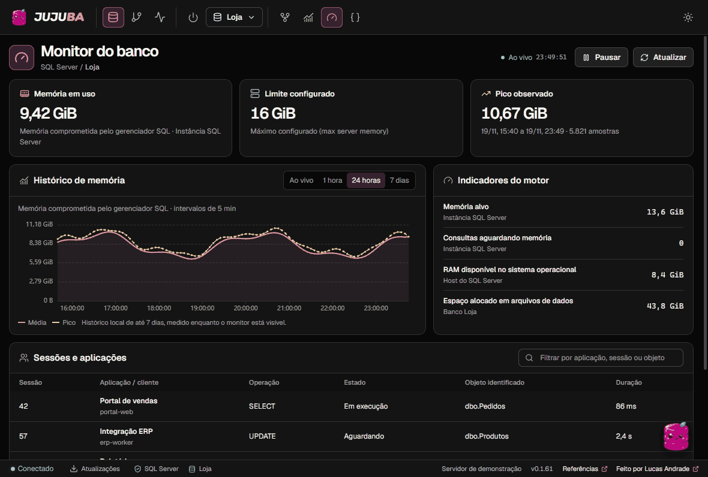
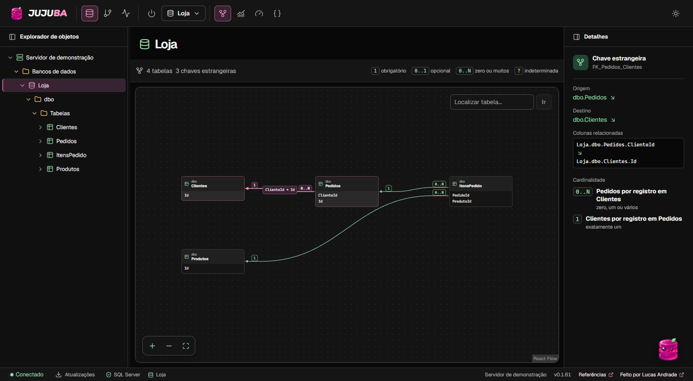
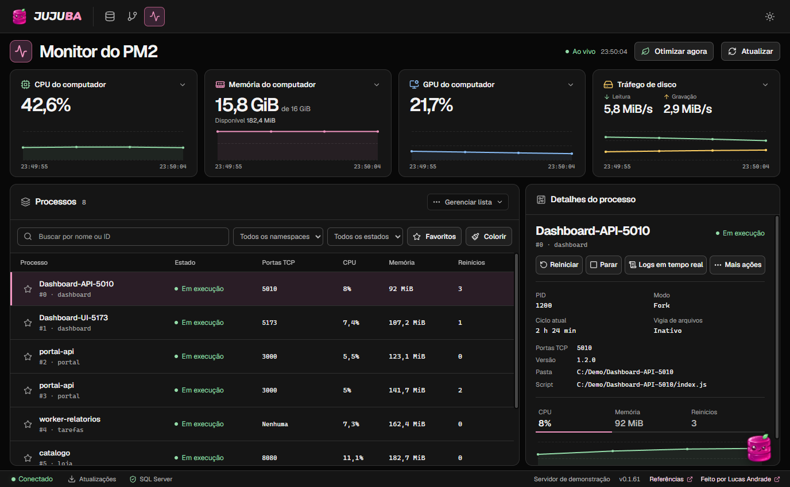
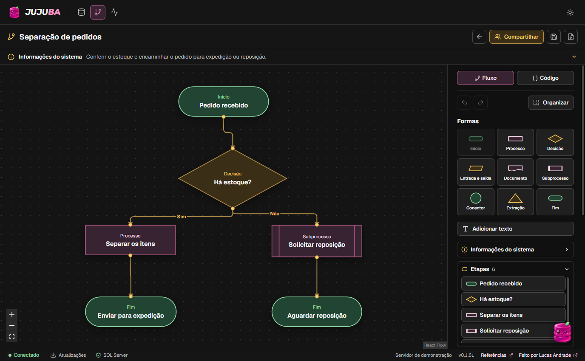

# JUJUBA

## ⬇️ [Baixar o instalador para Windows (64 bits)](https://github.com/valentelucass/jujuba/releases/latest)

<picture><source media="(prefers-reduced-motion: reduce)" srcset="docs/imagens/abertura.png" /></picture>

O JUJUBA reúne bancos de dados, processos do PM2 e fluxogramas com IA em um aplicativo para Windows. O explorador aceita SQL Server, MySQL, PostgreSQL, SQLite, MongoDB e Redis.

## JUJUBA em ação

No **Monitor do banco**, passe o mouse sobre o gráfico para ver a média e o pico de memória de cada intervalo. A animação mostra a troca de **24 horas** para **1 hora** e a busca por **Portal** para encontrar a sessão da aplicação. Todas as capturas deste guia usam dados de demonstração.



[Explorar bancos](#instalar-e-conectar) · [Monitorar memória](#monitorar-um-banco) · [Gerenciar o PM2](#monitorar-processos-do-pm2) · [Desenhar fluxogramas](#planejar-um-sistema-com-ia)

## Instalar e conectar

Na tela inicial, clique em **Nova conexão** e escolha o tipo de banco no centro. O painel direito mostra os bancos disponíveis e destaca a sua escolha. Para MySQL e PostgreSQL, informe servidor, porta e credenciais. Para PostgreSQL, indique também um banco inicial acessível. Para SQLite, abra um arquivo existente. Os três oferecem consultas, navegação, filtros e diagrama das chaves estrangeiras. O SQL Server também oferece edição de células e painéis de atividade e desempenho.

### MongoDB e Redis

- No MongoDB, informe uma URI `mongodb://` ou `mongodb+srv://`. Abra uma coleção para consultar documentos paginados e aplicar filtros JSON.
- No Redis, informe uma URI `redis://` ou `rediss://`. Indique o banco na URI, como `/2`, para abrir o `db2`. Busque chaves por padrão e confira tipo, valor e expiração.

### SQL Server

1. Execute o instalador x64 do JUJUBA. O aplicativo usa o runtime gratuito Microsoft Edge WebView2. O instalador pode baixar o runtime se ele ainda não estiver no Windows.
2. No menu Iniciar do Windows, abra **Jujuba** e selecione **Nova conexão**.
3. Se o SQL Server estiver no mesmo Windows, selecione **Neste computador**. Deixe **Instância local** em branco para a instância padrão. Esse modo usa a memória compartilhada do Windows e requer o Microsoft ODBC Driver 18 ou 17 para SQL Server, x64.
4. Para outro computador, selecione **Pela rede** e informe o nome DNS e a porta TCP do servidor. Use a rede privada ou a VPN, se aplicável. O certificado precisa corresponder ao DNS e ser confiável no Windows. Nos dois modos, escolha um usuário autorizado do SQL Server ou a conta atual do Windows. O JUJUBA preenche os dados da última conexão bem-sucedida. A senha de SQL pode ser lembrada neste PC.
5. Escolha um banco na lista pesquisável ou no explorador. Abra um esquema, a pasta **Tabelas** e uma tabela.

O login deve conseguir abrir o catálogo `master` para descobrir os bancos. Em cada banco, o SQL Server define quais objetos e registros o login pode consultar. A permissão `VIEW DEFINITION` nos objetos relevantes pode permitir classificar mais relações.

No **Diagrama do banco**, selecione a ligação entre duas tabelas para ver as colunas relacionadas. No exemplo, cada pedido aponta para um cliente, e um cliente pode ter vários pedidos.



## Monitorar um banco

Para interpretar o valor exato de RAM, entender as sessões visíveis e ler os tamanhos de tabelas e colunas, consulte o [guia do monitor SQL Server](docs/interpretar-monitor-sql-server.md).

Em **Bancos de dados**, escolha a conexão e o banco e abra **Monitor do banco** na barra superior. O painel consulta o servidor em modo de leitura. A tabela de sessões mostra a aplicação, o cliente e a operação quando o motor fornece esses dados. A coluna de objeto mostra a tabela ou coleção identificada durante a coleta. Os contadores acumulados por objeto têm o período indicado.

Para avaliar, por exemplo, um limite de 16 GiB no SQL Server, acompanhe a memória comprometida pela instância, o limite em vigor, a meta dinâmica, a fila de consultas aguardando memória e a RAM disponível no host. Compare também as amostras durante o horário de maior carga. Um pico construído pelo JUJUBA cobre as leituras feitas com o monitor aberto. O histórico guarda resumos locais de cinco minutos por até sete dias. [Monitorar o uso de memória no SQL Server](https://learn.microsoft.com/sql/relational-databases/performance-monitor/monitor-memory-usage)

Cada motor identifica o recurso que consegue medir. No MySQL, o painel compara os dados no buffer pool do InnoDB com o tamanho configurado desse cache. No SQLite, a medição é do cache da conexão do JUJUBA com o arquivo. As leituras dependem da versão e das permissões da conta conectada.

## Monitorar processos do PM2

Abra **PM2** na barra superior para acompanhar os processos gerenciados pelo PM2 da sua conta do Windows. O painel funciona sem conexão com um banco. Ele consulta a instância local em execução e respeita a pasta configurada em `PM2_HOME`. Para preparar a instalação ou iniciar seus serviços, consulte o [guia oficial do PM2](https://pm2.keymetrics.io/docs/usage/quick-start/).



Os cartões mostram CPU, memória disponível e usada, GPU e tráfego de disco do Windows, inclusive quando o PM2 está desconectado. Passe o mouse ou use Tab para abrir um cartão flutuante. CPU, GPU e disco mostram os seis maiores consumidores. A memória lista todos os processos identificados pelo Windows, inclusive os que não expõem o valor medido. Clique para fixar o cartão, busque um nome ou PID e expanda um aplicativo para ver as instâncias. Os subprocessos identificados na árvore do PM2 ficam junto do aplicativo correspondente.

A CPU usa como referência toda a capacidade do computador. A memória mostra os bytes de RAM privada residente e a porcentagem da RAM física. A GPU usa o motor mais ocupado que o driver expõe ao Windows. No disco, a porcentagem representa a parcela das leituras e gravações atribuídas aos processos medidos. A coleta detalhada de disco roda enquanto esse cartão está aberto. Quando o Windows fornece apenas E/S geral, o painel informa que a medida inclui rede e dispositivos.

No cartão de memória, **Analisar processos** explica quais aplicativos podem fechar ou reduzir o consumo e quais precisam continuar como estão. Fixar o cartão também consulta o parecer. A consulta é de leitura. Os indicadores do Windows mostram a memória dos pools do kernel, o cache do sistema e a memória em standby já disponível para reaproveitamento.

**Otimizar agora** reavalia os processos no momento do clique. O JUJUBA protege o PM2 e seus descendentes, serviços, bancos, processos com filhos e conexões de rede. Se o Windows ou o PM2 não confirmar os dados necessários, a operação é interrompida. Em aplicativos de desktop verificados, minimizados e ociosos, ele pode solicitar o fechamento normal de um utilitário descartável ou aviso informativo isolado. Quando o Windows sinaliza pressão de memória, também pode reduzir a RAM residente de outros aplicativos elegíveis, mantendo-os abertos. O relatório mostra cada ação e a RAM disponível no computador antes e depois. Os aplicativos podem voltar a carregar páginas ao serem usados novamente.

Para investigar diferenças entre a RAM usada e a soma dos processos, o RAMMap mostra como o Windows distribui a memória entre aplicativos, cache e sistema. [RAMMap da Microsoft](https://learn.microsoft.com/en-us/sysinternals/downloads/rammap)

Selecione um processo para ver o ID do PM2, o PID do Windows, o tempo de execução, os reinícios e o histórico de CPU e memória. As portas são as portas TCP que o Windows encontra em escuta em IPv4 e IPv6. Quando quem escuta é um subprocesso, a porta aparece no processo gerenciado mais próximo da árvore. As leituras são renovadas enquanto o painel está visível.

Nos detalhes, use **Iniciar** para retomar um processo parado, **Parar** para interrompê-lo e **Reiniciar** para iniciar outro ciclo. É possível remover o registro de um processo pelo seu ID. Em modo cluster, **Recarregar** atua sobre a instância selecionada. Alterar a quantidade de instâncias atua sobre o aplicativo inteiro e exige um nome de grupo único. [Gerenciamento de processos](https://pm2.keymetrics.io/docs/usage/process-management/) e [modo cluster](https://pm2.keymetrics.io/docs/usage/cluster-mode/)

Em **Mais ações → PowerShell de desenvolvimento**, o terminal abre na pasta do processo com as ferramentas locais de Node disponíveis em `node_modules/.bin`. Se o Visual Studio ou Build Tools fornecer o Developer PowerShell, o JUJUBA carrega esse ambiente na mesma janela. Os atalhos de logs e detalhes usam o ID selecionado. O monitor interativo `pm2 monit` mostra todos os processos da instância.

Para adicionar um serviço, escolha um script ou arquivo `ecosystem` no seletor do Windows e confirme o caminho. Salvar a lista grava o conjunto atual do PM2, inclusive quando está vazio. Restaurar a lista inicia os serviços salvos que estão ausentes. [Lista de processos persistente no PM2](https://pm2.keymetrics.io/docs/usage/startup/)

Use a estrela para favoritar um processo e o filtro **Favoritos** para ver os marcados. Para agrupar visualmente serviços relacionados, clique em **Colorir**, selecione suas linhas e aplique a mesma cor. Os favoritos e as cores ficam salvos neste computador.

## Planejar um sistema com IA

O ícone do assistente no canto inferior direito abre o mesmo chat em todas as telas. Descreva o fluxo ou anexe até quatro documentos de texto, como Markdown, TXT, JSON ou CSV. O assistente reconhece a tela atual e pode propor um fluxograma de sistema. Use **Abrir fluxograma no editor** para revisar. Em **Fluxogramas**, use as formas e as ferramentas do painel direito para desenhar manualmente. Arraste as etapas, edite as conexões e use **Desfazer**, **Refazer** ou **Organizar** quando precisar. O arquivo `.jujuba.json` guarda o fluxo e as posições. Você também pode exportar Markdown com Mermaid.



Para usar a conta de um assistente, instale o cliente oficial no Windows e entre nele primeiro. Em seguida, selecione-o no chat e clique em **Conexão → Verificar assistente**.

Ao escolher um assistente, o JUJUBA consulta os modelos do cliente instalado. Selecione o **Modelo** e, no Codex ou Claude, o **Raciocínio** disponível para ele. O Gemini CLI gerencia o raciocínio automaticamente. O aplicativo lembra a escolha de cada assistente para o chat, a pasta do projeto e a geração de código do fluxograma.

No cabeçalho do painel, clique no **chapéu** para abrir o guarda-roupa. Em **Cor da Jujuba**, escolha uma das seis cores ou use **Escolher outra cor**. A prévia muda na hora e o aplicativo guarda sua escolha.

Em **Ferramentas e sons**, uma bolha lançada com um clique busca a Jujuba e a leva para cima. Clique na bolha ou em **Estourar** para soltá-la. O **Ímã de filhotes** fica disponível quando há um filhote seu já nascido e livre. Guardar o ímã solta os filhotes na cena.

A **Bomba atômica** toca uma sirene, puxa a Jujuba e o clone para o ponto escolhido e os lança pela tela com a onda de choque. Os dois quicam nas bordas e continuam na brincadeira. O painel também reúne o trampolim, o ventilador e os controles de confeitos, cócegas e carimbos.

- **ChatGPT** usa o Codex instalado no computador. Na primeira vez, execute `codex login` e escolha entrar com o ChatGPT. [Autenticação do Codex](https://learn.chatgpt.com/docs/auth)
- **Claude** usa o Claude Code instalado no computador. Abra `claude` e siga a instrução de login. [Instalação e login do Claude Code](https://code.claude.com/docs/en/quickstart)
- **Gemini** usa o Gemini CLI instalado no computador. Abra `gemini` e escolha entrar com o Google para autenticar o cliente. Para editar código, marque a pasta do projeto como confiável no Gemini CLI. [Autenticação do Gemini CLI](https://geminicli.com/docs/get-started/authentication/)

Em **Código**, o assistente usa o fluxograma salvo para criar uma primeira implementação. Revise a prévia e escolha onde salvar os arquivos. No chat, clique no ícone de pasta para escolher um projeto e peça ajuda para entender ou editar seus arquivos. Ao enviar da tela **Fluxogramas**, o fluxo aberto acompanha o pedido. Os clientes usam a sessão configurada no Windows e enviam o pedido e o contexto de trabalho ao serviço escolhido.

Use o ícone do sol ou da lua na barra superior para trocar entre fundo branco e preto. O aplicativo lembra a sua escolha.

## Compartilhar um fluxograma

Em **Fluxogramas → Novo projeto**, informe a **Pasta do código** ou use **Vincular pasta** em um projeto existente. Com Node.js 22 ou superior e o Codex CLI conectado, o JUJUBA verifica as pastas enquanto está aberto e recupera mudanças feitas durante sua ausência na próxima abertura. O Codex recebe o inventário e uma seleção de trechos de código. A aba **Fluxo da pasta** mostra a visão geral, as telas e os processos com referências aos arquivos. O desenho manual e suas notas ficam disponíveis na aba ao lado.

Em **Fluxogramas → Meus projetos**, crie um projeto ou importe um arquivo `.jujuba.json`. As edições ficam salvas no projeto, e **Salvar arquivo** permite manter uma cópia em arquivo.

Abra o projeto, clique em **Compartilhar** e envie o código pelo canal de sua preferência. A outra pessoa abre **Entrar por código** no próprio JUJUBA. Após a aprovação, vocês veem o fluxograma e o cursor um do outro. Use a mesma versão do JUJUBA nos dois computadores. Use **Passar edição** para alternar quem pode editar. O acesso termina ao fechar a sessão. As alterações ficam no projeto do dono, e o convidado pode salvar uma cópia própria.

A conexão criptografada usa [Iroh](https://github.com/n0-computer/iroh), com conexão direta quando possível e retransmissão do tráfego pelo serviço público do Iroh quando necessário. Os dois computadores precisam de conexão com a internet.

## Desenvolver e compilar

Requisitos no Windows x64:

- Node.js 22.12 ou superior e npm.
- Rust estável com o alvo `x86_64-pc-windows-msvc`.
- Microsoft C++ Build Tools com o Windows SDK e Microsoft Edge WebView2.

Na pasta do projeto, rode:

```powershell
Set-Location frontend
npm ci
npm run desktop -- dev
```

Para gerar o instalador:

```powershell
npm run desktop -- build
```

O pacote NSIS é gerado em `backend/rust/target/release/bundle/nsis/`. A entrega inicial usa um instalador x64 sem assinatura comercial. O pacote pode ser distribuído internamente conforme a política do Windows da empresa. Para executar os testes Rust, rode `cargo test --manifest-path backend/rust/Cargo.toml` a partir da raiz.

## Organização

- `frontend/src/models` define os tipos de catálogo, dados, conexão e relações. `controllers` coordena seleção, expansão e chamadas tipadas. `views` renderiza a interface Estúdio.
- `backend/rust/src` mantém os comandos Tauri, casos de uso e os adaptadores de catálogo, registros e conexões em `sql_server`. A ponte expõe comandos distintos para consulta SQL e edição de células. Na grade, os valores são parametrizados e os identificadores vêm do catálogo.
- `database` contém as instruções de validação com um banco existente ou isolado.

## Escopo da primeira versão

A árvore carrega os esquemas com tabelas visíveis e permite expandir as colunas. A grade pagina por 25, 50 ou 100 registros, filtra por trecho textual e ordena tipos compatíveis. Usa uma chave única visível quando possível para estabilizar a ordem. Valores textuais longos e binários são apresentados em prévia e valores CLR aparecem identificados como tal.

Selecione um banco para ver todas as tabelas e relações declaradas que o login consegue consultar. A aba Diagrama de uma tabela mostra as relações diretamente ligadas a ela, incluindo relações compostas e autorreferentes. Tabelas sem relações visíveis aparecem no grafo. Arraste os cartões das tabelas e os rótulos das relações para ajustar a visualização. A classificação usa a nulabilidade das colunas, a unicidade dos índices e a visibilidade dos metadados. O diagrama mostra a cardinalidade nas pontas da linha e explica os limites de cada lado no painel de detalhes. Quando a informação é insuficiente, a interface marca a cardinalidade como indeterminada.

## Consultar e editar

- **SQL** executa um único `SELECT` no banco escolhido. O editor aceita consultas com junções e CTEs e mostra até 200 linhas. O login deve ter as permissões de leitura exigidas pela consulta.
- Em **Dados → Editar células**, selecione uma célula compatível, informe o valor e revise a prévia antes de gravar. A edição exige permissão de `UPDATE`, chave primária compatível e confirmação. Se o valor original mudou, o JUJUBA pede para atualizar a tabela. A primeira versão edita uma célula de texto ou de número inteiro por vez.
- Use uma conta com as permissões adequadas ao trabalho. Para testar gravações, use uma tabela autorizada em um banco de testes.

## Dashboards do banco

MySQL, PostgreSQL, SQLite, MongoDB e Redis têm um painel com métricas do banco selecionado. MySQL e PostgreSQL também exibem o espaço alocado nas maiores relações. Os dados dependem das permissões da conexão. No Redis, a memória, os clientes e as operações por segundo descrevem o servidor, enquanto a contagem de chaves se refere ao banco selecionado.

No SQL Server, selecione um banco e abra **Dashboards**. **Visão geral** mostra os objetos visíveis e um gráfico de capacidade por tipo de arquivo. Em **Armazenamento**, clique em uma tabela para ver o tipo e o tamanho dos valores de cada coluna em bytes. Tabelas pequenas têm leitura completa. Nas maiores, o painel identifica as linhas lidas e, quando há amostragem por páginas, estima o total por coluna. **Medir todas as linhas** faz uma leitura completa sob demanda. O espaço físico da tabela inclui índices e estruturas de página e reflete a compressão. **Desempenho** consulta o Query Store em períodos de 24 horas, 7 dias ou 30 dias. Alterne entre linha e barras para comparar duração média, número de execuções e tempo acumulado.

**Ao vivo** mostra solicitações em andamento, tipos de espera, sessões bloqueadoras e atividade de leitura e gravação por arquivo. Use **Só bloqueadas** para focar nos bloqueios por outras sessões. A atualização automática é opcional, roda a cada 15 segundos enquanto o painel está aberto e pausa se a leitura falhar. O painel exige permissão de monitoramento da instância e filtra as solicitações pelo banco selecionado.

Os painéis usam a conexão já aberta e as permissões do login. Estatísticas de partições e histórico podem exigir permissões adicionais de monitoramento. O JUJUBA só consulta os metadados e o histórico disponível. A granularidade depende dos intervalos que o Query Store registrou.

## Reconectar e lembrar credenciais no Windows

Após uma conexão bem-sucedida com SQL Server, MySQL ou PostgreSQL, o JUJUBA salva a senha no Gerenciador de Credenciais da sua conta do Windows, vinculada ao servidor, à porta ou instância e ao usuário. Na próxima vez, clique em **Conectar** para usar a senha salva. Use **Digitar outra senha** para substituí-la após uma conexão válida ou **Esquecer senha salva** para removê-la.

MongoDB e Redis guardam a URI da última conexão bem-sucedida no mesmo gerenciador. Use **Digitar outra URI** para trocar a conexão ou **Esquecer URI salva** para removê-la. O SQLite lembra o caminho do último arquivo aberto.

Se fechar o aplicativo com uma sessão ativa, o JUJUBA volta a se conectar ao mesmo servidor ou arquivo na próxima abertura. Ele reabre o último banco selecionado quando esse banco ainda está acessível. Depois de clicar em **Desconectar**, use o atalho **Reconectar** para restabelecer a sessão quando quiser.

## Atualizações no Windows

Clique em **Atualizações** no rodapé para instalar a nova versão. Se o JUJUBA reabrir na versão anterior, a partir da 0.1.64 o botão **Baixar instalador oficial** abre o download daquela versão no GitHub. Salve seu trabalho, feche o aplicativo e execute o instalador. Em versões anteriores, use o link de download no topo deste guia.

Se o Windows bloquear o instalador em um computador corporativo, mantenha a instalação atual e envie à TI a versão exibida no rodapé, o texto completo do aviso e o link da release. A tela de atualização distingue falha de download, falha de verificação e recusa ao iniciar o instalador. Se o Windows devolver o controle sem concluir a troca, o JUJUBA compara a versão na abertura seguinte.

O JUJUBA verifica cada pacote com a chave do atualizador. A distribuição atual não possui assinatura de editor Windows (Authenticode). A TI pode conferir o SHA-256 publicado em cada release e avaliar a aprovação conforme a política da organização. Para distribuição com um editor verificado, a organização precisa assinar o executável e o instalador com uma identidade de assinatura de código reconhecida. [Reputação do SmartScreen para desenvolvedores](https://learn.microsoft.com/windows/apps/package-and-deploy/smartscreen-reputation)

Instale a versão 0.1.14 ou posterior uma vez. O JUJUBA procura uma release ao abrir, ao voltar à janela e a cada cinco minutos. Quando encontra uma atualização, o rodapé exibe o número da versão disponível ao lado do estado da conexão. Abra **Atualizações**, salve seu trabalho e clique em **Atualizar agora**. O aplicativo valida a assinatura do instalador antes de iniciá-lo e reinicia após a instalação.

Para distribuir uma versão, atualize as versões do frontend e do backend, incluindo os arquivos de dependências, e envie a tag correspondente, como `v0.1.15`. O workflow **Release Windows** compila o instalador x64, assina o pacote e publica os arquivos em uma Release. A chave pública está na configuração do Tauri. A chave privada fica no secret `TAURI_SIGNING_PRIVATE_KEY` do GitHub Actions e deve ter uma cópia protegida. As instalações existentes confiam nessa chave.

## Validação na empresa

Para testar conexões pela rede, use um DNS coberto pelo certificado do servidor e um login autorizado. Na própria máquina do SQL Server, teste também a conexão por memória compartilhada.

Com a conexão aprovada, selecione `ETL_SISTEMA` e `ETL_SISTEMA_V2` se ambos estiverem acessíveis, ou dois bancos de teste autorizados. Abra uma tabela em cada banco, avance uma página, aplique filtro e ordenação e compare uma FK visível com o SSMS. Repita a conexão no PC pela rede privada ou VPN.

## Testes desta entrega

- Compilação TypeScript e Vite, binário Tauri x64 e pacote NSIS concluídos. A janela do JUJUBA abriu no Windows e apresentou a tela de conexão.
- Três testes Rust locais passaram, cobrindo validação do nome do servidor e cardinalidade. Um teste separado com o conector Rust confirmou a rejeição de um certificado não confiável.
- O parser T-SQL do SSMS aceitou oito consultas de catálogo e leitura. O teste local da interface, com respostas de teste na ponte, passou para navegação por teclado, troca entre dois bancos, descarte de resposta obsoleta, paginação, ordenação, filtros, estrutura, permissões e FKs compostas e autorreferentes.
- A descoberta dos bancos e a abertura de tabelas pela conexão local foram verificadas no Windows. Valide o catálogo completo e eventuais gravações em um banco de teste autorizado.

## Referências

- Visualização do consumo de recursos por processo no Windows. [System Informer](https://github.com/winsiderss/systeminformer)
- Ícones dos bancos de dados de [Devicon](https://github.com/devicons/devicon/tree/v2.17.0), com licença em `frontend/src/assets/devicon-LICENSE.txt`.

- [ByteTable, commit a56ee2d](https://github.com/Rezwanul-Haque/byteTable/tree/a56ee2db01389ae24fbb8b64a3ffddb13375ec45) para arquitetura, catálogo e grade.
- [VeloxDB, commit ed58ff7](https://github.com/veloxbase/veloxdb/tree/ed58ff79acba554dd56444e54f6cdca64dede246) para árvore e diagrama.
- [Tabularis SQL Server Plugin, commit 5e03e8d](https://github.com/TabularisDB/tabularis-sqlserver-plugin/blob/5e03e8dec3fe29169e716b78d8c63a0b5091a2c5/src/driver/pool.rs) para autenticação integrada e verificação TLS.
- [OpenMetadata](https://github.com/open-metadata/OpenMetadata) para catálogo e dependências. [HyperDX](https://github.com/hyperdxio/hyperdx) para controles de filtros e resultados. [Trigger.dev](https://github.com/triggerdotdev/trigger.dev) como referência para histórico de ETL.
- [Apache ECharts](https://github.com/apache/echarts-examples) para os gráficos de armazenamento e desempenho. [Grafana para SQL Server](https://github.com/grafana/grafana-mssql-datasource) como referência para séries temporais e filtros por período.
